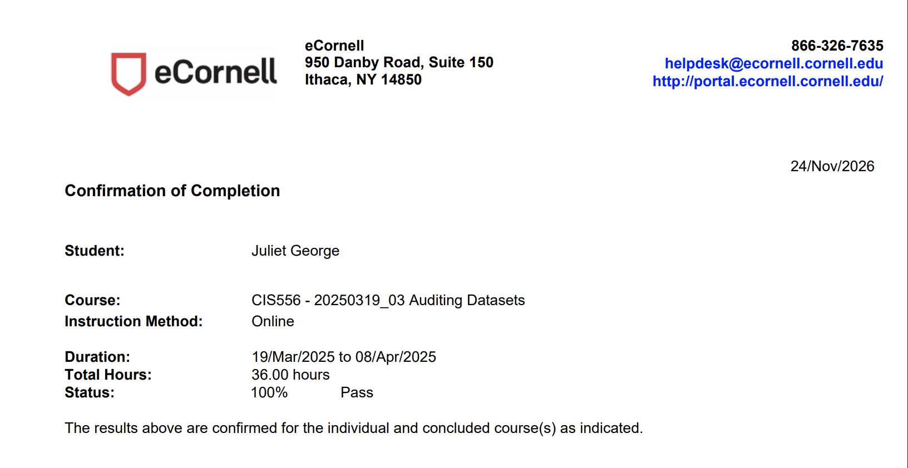

# Auditing Datasets

The final course in the eCornell Software Engineering with Python certificate
(CIS556 – Auditing Datasets).

## What it does

`auditor` is a command-line Python app that audits a flight school's records. It
checks whether any student takeoffs broke the weather limits set by the school's
insurance agreement. For each lesson, it compares the weather at takeoff against
the minimums for that student's certification level, the type of flight (VFR or
instrument), the practice area, and whether it was day or night. Any lesson that
broke a limit (ceiling, visibility, wind or crosswind) is flagged.

It combines several data files (CSV and JSON): lessons, students, airplanes,
hourly weather, sunrise/sunset times, and weather minimums. It prints how many
violations it found and can write them to a CSV file.

## Project layout

- `auditor/` – the main application
  - `app.py` – loads the files and runs the audit
  - `violations.py` – weather checks (ceiling, visibility, wind)
  - `pilots.py` – looks up each pilot's certification, ratings and minimums
  - `utils.py` – helpers for reading/writing CSV and JSON and handling time zones
  - `tests/` – unit tests and sample data
- `module_one/` – practice scripts for reading and writing text, CSV and JSON files
- `module_two/` – practice scripts for working with dates, times and time zones
  (`datetime`)

## Skills practiced

File I/O (CSV, JSON), `datetime` and time zones, writing functions to a spec,
unit testing, and building a command-line application.

## Usage

    python auditor <directory> [output.csv]

